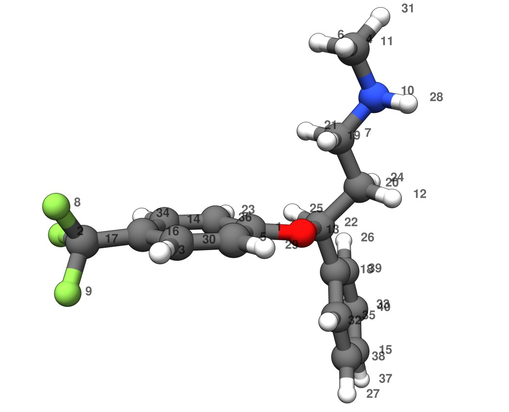
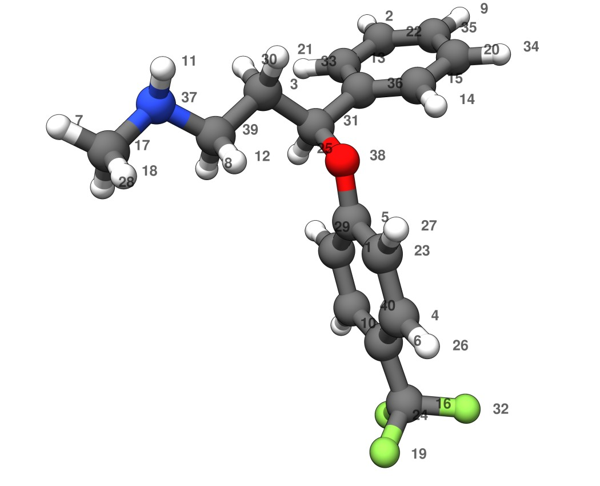

<div align="center"> 


<h1>iRMSD</h1>
<h3><em>Molecular Structure Comparison and Ensemble Pruning</em></h3>

[](https://github.com/pprcht/irmsd/releases/latest)
[](http://dx.doi.org/10.1021/acs.jcim.4c02143)
[](https://www.gnu.org/licenses/lgpl-3.0)
[](https://pprcht.github.io/irmsd/) <br>
[](https://github.com/pprcht/irmsd/actions/workflows/wheels.yml)
[](https://github.com/pprcht/irmsd/actions/workflows/tests-and-coverage.yml)
[](https://codecov.io/gh/pprcht/irmsd)

</div>


---

**iRMSD** is a toolkit for *molecular structure comparison* and *ensemble pruning* based on the permutation-invariant RMSD.
A Python API and a command-line tool sit on top of a Fortran backend that handles conformer ensembles with thousands of structures.

* iRMSD and quaternion RMSD with symmetry handling, canonical atom identifiers, and optimal superposition
* Grouping and pruning of conformer ensembles via RMSD and (optional) energy thresholds, parallelized with OpenMP
* A `Molecule` class with XYZ/extXYZ input and output, and interfaces to ASE and RDKit
* Structural properties: coordination numbers, rotational constants, point groups
* Low-level wrappers of the Fortran routines next to the high-level Python functions

iRMSD is meant for conformational sampling, machine learning for molecules, and structural chem-informatics, and works with structures from ASE, RDKit, CREST/xtb, or any other source of XYZ files.

<p align="center">
  
  
</p>

The two structures above are copies of the same fluoxetine conformer, randomly rotated and with a random atom order (the labels are the atom indices in each file).
Kept in the atom order of the files, their quaternion RMSD is 5.13 Å; the iRMSD aligns the copies, restores the atom order, and finds them identical:

```console
$ irmsd compare examples/xyz/fluoxetine_1.xyz examples/xyz/fluoxetine_2.xyz | tail -1
iRMSD: 0.0000879250 Å
```

## Quick start

```bash
pip install irmsd
```

Wheels are available for Linux, macOS (arm64), and Windows (x86\_64).
The same install provides the `irmsd` command-line tool:

```bash
irmsd compare struc1.xyz struc2.xyz        # iRMSD between two structures, atom order restored
irmsd sort ensemble.xyz -o unique.xyz      # prune an ensemble to its unique structures
```

and the Python API:

```python
import irmsd

molecules = irmsd.read_structures("ensemble.xyz")        # one Molecule per frame
unique = irmsd.prune(molecules, rthr=0.125)              # RMSD threshold in Å
irmsd.write_structures("unique.xyz", unique)
```

## Documentation

The documentation is hosted at <https://pprcht.github.io/irmsd/>.

| Topic | Page |
|---|---|
| Wheels, OpenMP, building from source | [Installation](https://pprcht.github.io/irmsd/installation.html) |
| The iRMSD method, a worked example, known limitations | [Scientific background](https://pprcht.github.io/irmsd/background.html) |
| Interactive flowchart of a single comparison, step by step | [How a comparison works](https://pprcht.github.io/irmsd/algorithm.html) |
| Rotamers, randomized atom order, clusters, ensemble pruning, timings | [Examples](https://pprcht.github.io/irmsd/examples.html) |
| `irmsd prop`, `compare`, and `sort`, with all options | [Command-line tool](https://pprcht.github.io/irmsd/cli.html) |
| `Molecule`, comparison, sorting, ASE and RDKit, canonical identifiers | [Python interface](https://pprcht.github.io/irmsd/python.html) |
| All functions and classes | [Package reference](https://pprcht.github.io/irmsd/package_reference.html) |

## Citation

If you use iRMSD in academic work, please cite

> P. Pracht, *J. Chem. Inf. Model.* **2025**, *65* (9), 4501–4511.
> [doi:10.1021/acs.jcim.4c02143](https://doi.org/10.1021/acs.jcim.4c02143)

A publicly accessible preprint is available at [doi:10.26434/chemrxiv-2024-qmcz4](https://doi.org/10.26434/chemrxiv-2024-qmcz4).

## License
This project is licensed under the GNU Lesser General Public License (LGPL), version 3.0 or later.
You are free to use, modify, and redistribute the software under the terms of this license.
See the LICENSE file for the full text.

**Disclaimer:**  
This software is provided *“as is”*, without any warranty of any kind, express or implied,
including but not limited to warranties of merchantability, fitness for a particular purpose,
and noninfringement. In no event shall the authors or contributors be liable for any claim,
damages, or other liability arising from the use of this software.

© 2025 Philipp Pracht, Tobias Kaczun.


<!-- 
---

# OTHER TODOs
- [ ] docstrings and actual docs (GH pages?)
- [ ] conda-forge package
- [x] ci.yml/wheels.yml
- [x] codecov
- [x] (implementation) Parallelization via OpenMP (iRMSD sort)
- [x] (implementation) Optional pass of inter-conformer energy threshold (`ethr`)
- [x] (implementation) Pre-alignment via quaternion RMSD of unique canonical atoms instead of aligning via rotational constants
- [x] (implementation) "classical" CREGEN pruner based on energy + rot.const. + quaternion RMSD

-->
