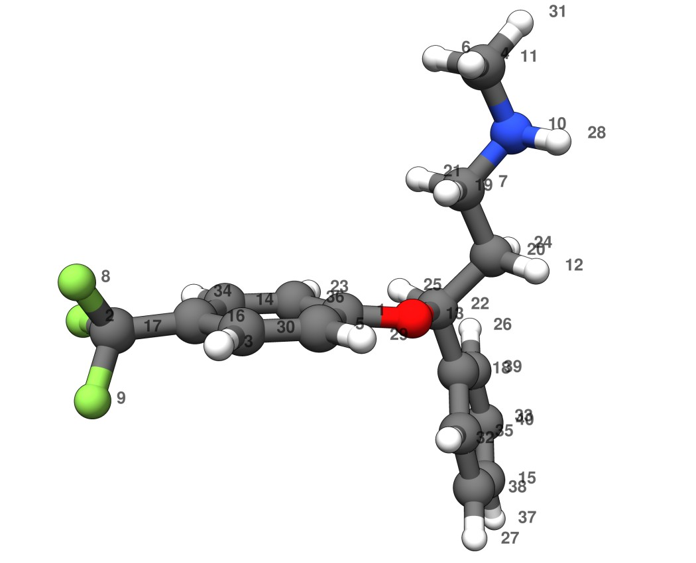
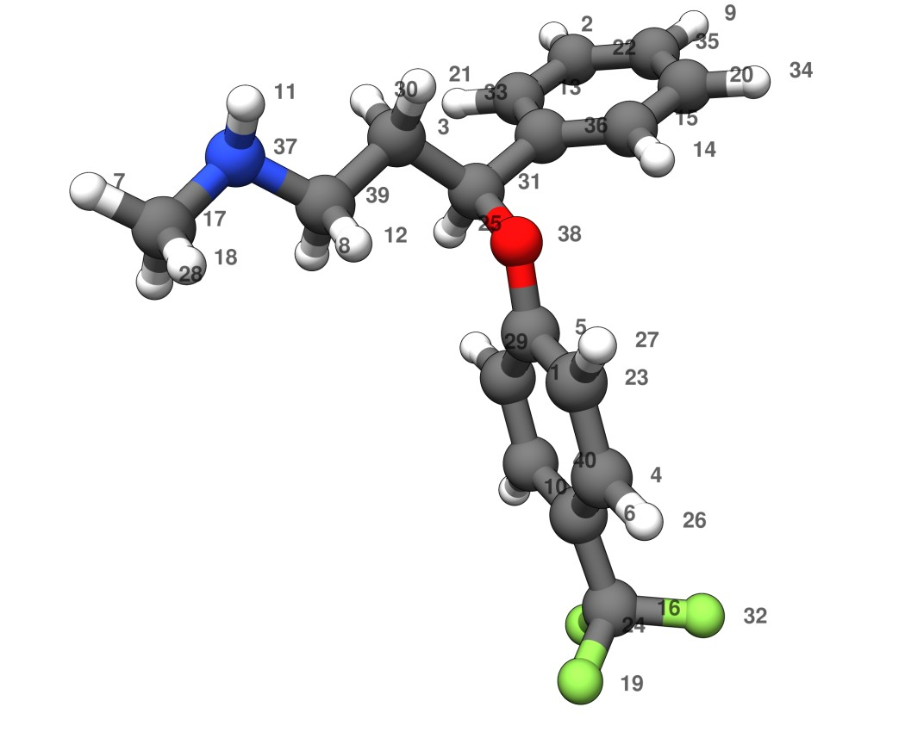

# Scientific background

Structural comparison is at the heart of conformational analysis, docking, trajectory processing, and molecular shape workflows.
The classical Cartesian RMSD fails whenever two structures differ by atom ordering, local symmetry, or rotameric permutations.
In such cases the RMSD becomes artificially large even though the molecular properties (e.g. IR/Raman spectra, NMR shifts, energies) are identical.

## The permutation-invariant RMSD

The RMSD with optimal alignment *and* permutation is defined as

$$
\mathrm{iRMSD}(\mathbf{X}, \mathbf{Y}) = \min_{\mathbf{P},\mathbf{U}} \sqrt{ \frac{1}{N} \sum_{i=1}^{N} \left\lVert \mathbf{X}_i - (\mathbf{P}\mathbf{U}\mathbf{Y})_i \right\rVert^2 }
$$

where **X** and **Y** are the Cartesian coordinates of the two structures, **U** is a rotation matrix, and **P** is a permutation matrix representing the atom–atom assignment.
The minimization yields the best superposition together with the best atom correspondence.

The iRMSD implemented in this package obtains **U** and **P** by

- assigning **canonical atom identities** that do not depend on the input atom order,
- performing a **symmetry-aware alignment** via a divide-and-conquer approach,
- solving the **linear sum assignment problem** (LSAP, Hungarian algorithm) in Fortran,
- handling **false enantiomers** when appropriate,
- using **cached memory and a single-precision LSAP kernel** for speed.

This makes the iRMSD applicable to large ensembles (thousands of conformers), proteins, and noncovalent clusters.
The method is described in detail in

> P. Pracht, *J. Chem. Inf. Model.* **2025**, *65* (9), 4501–4511.
> [doi:10.1021/acs.jcim.4c02143](https://doi.org/10.1021/acs.jcim.4c02143)
> (open-access preprint: [doi:10.26434/chemrxiv-2024-qmcz4](https://doi.org/10.26434/chemrxiv-2024-qmcz4))

## Example: restoring atom order

The two structures below are copies of the same fluoxetine conformer.
Both have an entirely random atom order and are randomly rotated.




<details>
<summary>Coordinates, <code>examples/xyz/fluoxetine_1.xyz</code></summary>

```{literalinclude} ../examples/xyz/fluoxetine_1.xyz
:language: text
```

</details>

<details>
<summary>Coordinates, <code>examples/xyz/fluoxetine_2.xyz</code></summary>

```{literalinclude} ../examples/xyz/fluoxetine_2.xyz
:language: text
```

</details>

The iRMSD aligns the structures (determines **U**) and restores the atom order (determines **P**):

```console
$ irmsd compare examples/xyz/fluoxetine_1.xyz examples/xyz/fluoxetine_2.xyz | tail -1
iRMSD: 0.0000879250 Å
```

The aligned copies agree to about 1e-4 Å, the precision of the input coordinates, while the quaternion-based Cartesian RMSD of the same pair in the atom order of the files (`--quaternion`) is 5.13 Å.

Further examples are collected in [](examples.md).

## Known limitations

- **Atom exchange between fragments** in noncovalent complexes: the canonical assignment of two subgraphs (molecules that share no covalent bond) is done independently.
  Atoms of the same element may therefore exchange across fragments, as in the (H<sub>2</sub>O)<sub>21</sub> and LJ<sub>75</sub> examples.
  If the largest bonded fragment holds less than half of the heavy atoms, the result of the LSAP is used without the bond-preserving selection.
- **Constitutional isomers**, structures that share a sum formula but differ in connectivity, are not flagged.
  If their number of atoms per canonical rank differs, the comparison falls back to matching atoms by element; otherwise it pairs ranks that do not correspond chemically.
  In both cases a value is returned without a warning (e.g. 1.40 Å for n-pentane against neopentane).
- **Bond detection**: bonds are derived from a coordination-number criterion.
  Noisy or distorted structures close to that threshold can change the detected bond graph, after which the comparison falls back to element types or a plain RMSD.
- **Local search**: the bond-preserving assignment is polished by changing one choice at a time, so coupled choices can be missed and the iRMSD can end up slightly above the lowest bond-preserving RMSD (7 of 200 ibuprofen conformer pairs in the tests).
- **Pairwise comparisons over an ensemble**: every call of `get_irmsd_molecule` (or `irmsd compare`) sets up the canonical ranks of both structures and allocates its work memory anew.
  Looping it over the pairs of a large set of structures repeats this setup for every pair, which dominates the run time for large molecules.
  Attaching the canonical identifiers once per structure ([](python.md#canonical-atom-identifiers)) removes the repeated rank setup.
  The ensemble sorter (`irmsd sort`, `sorter_irmsd_molecule`, `prune`) goes further: it sets up the ranks once per structure and the work memory once per thread, skips structures already assigned to a group, and runs in parallel.
  For 30 BPTI copies (435 pairs, one thread), the pairwise loop takes 14.7 s, 8.4 s with the identifiers attached, and the sorter 0.7 s.

Two limitations of earlier versions no longer apply.
Highly symmetric structures (e.g. C<sub>60</sub>, adamantane) have degenerate rotational axes, which version 0.1.2 could not always resolve: of 50 randomized copies with 0.02 Å coordinate noise, it misaligned 8 for adamantane and 33 for C<sub>60</sub>, by up to 0.9 Å, while the current version matches all of them.
The iRMSD of two different conformers could exceed their quaternion RMSD in the original implementation (Example 4, panel b); since version 0.1.2 this no longer occurs for that ensemble (see [](examples.md#comparison-with-later-versions)).
