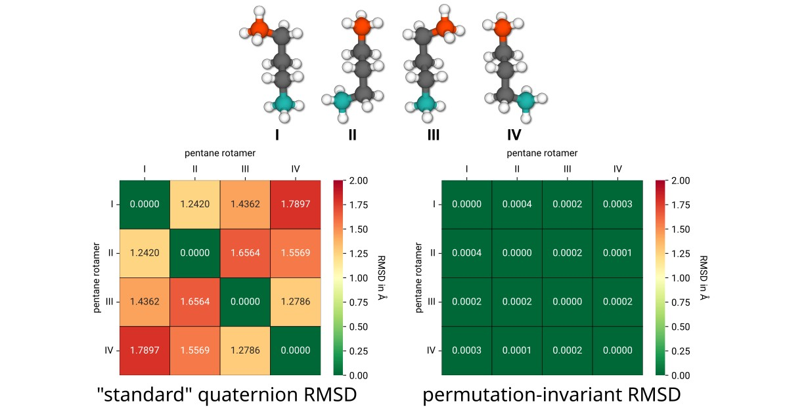
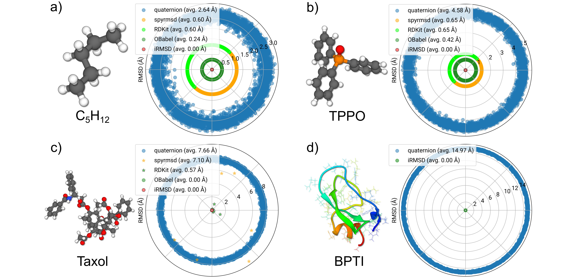
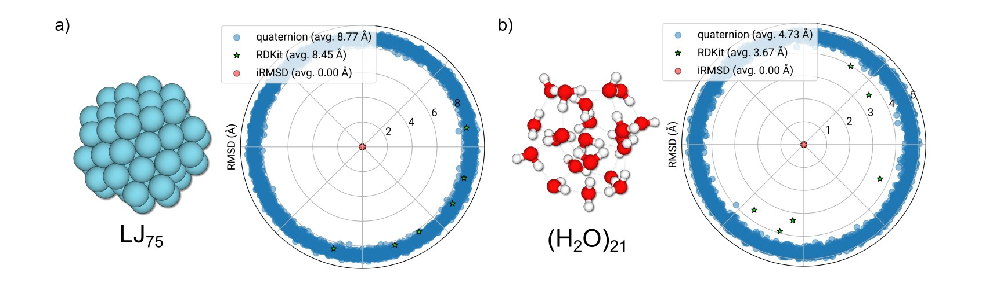
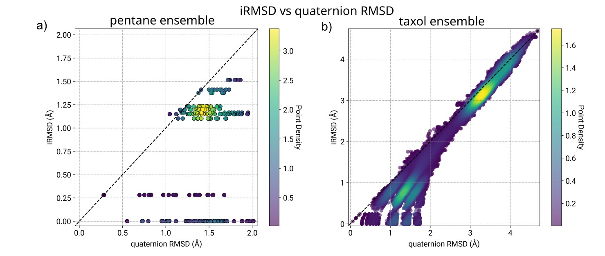
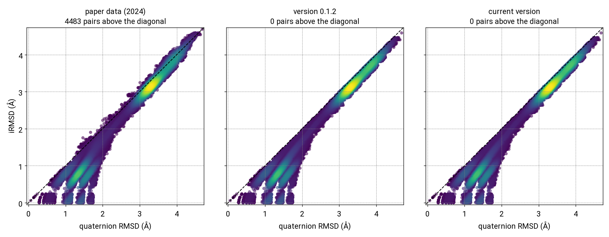

# Examples

Examples 1–4 are taken from
P. Pracht, *J. Chem. Inf. Model.* **2025**, *65* (9), 4501–4511
([doi:10.1021/acs.jcim.4c02143](https://doi.org/10.1021/acs.jcim.4c02143)).
Figure and page numbers refer to that article.

## Example 1: symmetric rotamers of pentane



Most pentane conformers have four rotamers that differ only by a permutation or inversion of the terminal methyl groups.
As shown in Figure 3 of the paper (page 3),

- the conventional RMSD between these rotamers ranges from 1.2 to 1.8 Å,
- the iRMSD identifies all of them as identical (≈ 0.0 Å) by accounting for permutations and false enantiomers,
- property calculations (IR spectra, NMR shifts) confirm that they are physically equivalent.

This simple case shows why conformer comparison based on the classical (quaternion) RMSD has to address both the alignment and the permutation problem.

A three-frame pentane ensemble is included as `examples/extxyz/pentane_ensemble.extxyz` and reduces to a single structure on sorting:

```bash
irmsd sort examples/extxyz/pentane_ensemble.extxyz
```

## Example 2: randomized atom order



A permutation-aware alignment has to classify two structures as identical even if they are

- randomly rotated,
- given in a randomly permuted atom order,
- (optionally) mirror images of each other ("false enantiomers").

Figures 7a–d (pages 6–7) show that the iRMSD returns ~0 Å for every pair among 100 randomized copies of pentane (12 atoms), TPPO (46 atoms), taxol (113 atoms), and BPTI (892 atoms).

### Timings compared to version 0.1.2

The canonical rank setup was rewritten after version 0.1.2 (breadth-first searches from the heavy atoms instead of a Floyd–Warshall pass over all atoms), and the iRMSD comparisons inside the ensemble sorting now run in parallel with OpenMP.
Both changes matter most for large molecules.
The table compares the 0.1.2 release from PyPI with the current development version on ensembles of 100 copies of one structure each, in random atom order, randomly rotated and translated.

| System | Atoms | Pairwise iRMSD, 0.1.2 | Pairwise iRMSD, now | Sorting, 0.1.2 | Sorting, now (1 thread) | Sorting, now (8 threads) |
|---|---:|---:|---:|---:|---:|---:|
| pentane | 17 | 0.10 ms | 0.19 ms | 3 ms | 12 ms | 5 ms |
| TPPO | 35 | 0.34 ms | 0.43 ms | 17 ms | 31 ms | 11 ms |
| (H<sub>2</sub>O)<sub>21</sub> | 63 | 0.67 ms | 0.71 ms | 42 ms | 59 ms | 15 ms |
| LJ<sub>75</sub> | 75 | 1.5 ms | 1.7 ms | 106 ms | 153 ms | 29 ms |
| taxol | 113 | 4.0 ms | 0.92 ms | 186 ms | 59 ms | 32 ms |
| BPTI | 892 | 1602 ms | 35 ms | 81.0 s | 2.4 s | 1.2 s |

For BPTI, a single comparison is 46 times faster than in 0.1.2, and sorting the ensemble takes 1.2 s instead of 81 s.
Below about 100 atoms, a comparison now costs slightly more on a single thread, because each assignment is additionally checked against a bond-preserving alternative (the centre walk, see [](algorithm.md)); with OpenMP the sorting is still faster than before.
Both versions sort every ensemble into a single group, with pairwise iRMSD values below 10<sup>−4</sup> Å.

"Pairwise" is the mean time of `get_irmsd_molecule` for the first copy against ten others, "sorting" the time of `sorter_irmsd_molecule` for all 100 copies at the default `rthr` of 0.125 Å.
The timings were taken with Python 3.12 on Linux, on an Intel Core i9-14900HX with eight threads available.

## Example 3: noncovalent clusters



Noncovalent clusters such as LJ<sub>75</sub> and (H<sub>2</sub>O)<sub>21</sub> break most RMSD algorithms, because the molecular graph is disconnected and, for LJ<sub>75</sub>, all atoms are of the same type, which leaves graph-isomorphism methods with nothing to work on.

The iRMSD handles these cases since the canonical atom identities do not require a connected graph (they fall back to the atom types), and the LSAP resolves the remaining permutation.
For LJ<sub>75</sub>, the full 75×75 LSAP is solved.

## Example 4: conformer–rotamer ensemble pruning



A single threshold (`RTHR`) separates

- rotamers (the same conformer, iRMSD ≈ 0 Å) from
- different conformers (larger iRMSD values).

This is what automated pruning of conformer–rotamer ensembles (CREs) needs, and it extends the conventional quaternion-RMSD pruning used, e.g., in CREST.
The default `RTHR` in `irmsd` is **0.125 Å**, adapted from the CREGEN procedure of CREST.
Further thresholds for the energy difference (`ETHR`) or the rotational constants (`BTHR`) are not required, but can be used to presort the ensemble and save time.

### Comparison with later versions

In panel b, computed with the original implementation in CREST, some pairs lie above the diagonal: their iRMSD exceeds the quaternion RMSD, i.e. the RMSD of the atom assignment already given by the input order.
The plot below shows the same 1719 taxol rotamers for a random 5% of all pairs (73,831): the values from the paper next to those of version 0.1.2 and of the current version.



In the paper data, 4483 pairs lie more than 0.01 Å above the diagonal, by up to 0.29 Å; since version 0.1.2, none do.
The bond-preserving selection added after 0.1.2 changes 12 of the pairs by more than 0.01 Å, which is not visible at this scale.
For three of them the iRMSD rises by up to 0.19 Å, because the lower 0.1.2 value came from an atom assignment that broke eight bonds; the current version returns the lowest RMSD among assignments that keep every bond.
